[README.md](https://github.com/user-attachments/files/34288253/README.md)
<div align="center">


# GoLAN

### شبکه‌ی مجازی نظیر‌به‌نظیر برای بازی، چت، صدا و اشتراک فایل
**بدون سرور · بدون تنظیم روتر · رمزنگاری‌شده · کاملاً فارسی**

<sub>A peer-to-peer virtual LAN for gaming, chat, voice and file sharing — no server, no router setup.<br>قبلاً با نام Virtual LAN Platform · formerly Virtual LAN Platform</sub>

<br>

[](https://github.com/parhamzare139/VirtualLANPlatform/releases/latest)
[](https://github.com/parhamzare139/VirtualLANPlatform/releases)
[](#نصب-و-شروع-سریع)
[](#tech-stack)
[](LICENSE)
[](https://github.com/parhamzare139/VirtualLANPlatform/commits/main)

**[⬇ دانلود](https://github.com/parhamzare139/VirtualLANPlatform/releases/latest) · [📋 تغییرات نسخه‌ها](https://github.com/parhamzare139/VirtualLANPlatform/releases) · [🐞 گزارش مشکل](#پشتیبانی-و-گزارش-مشکل) · [💛 حمایت از پروژه](https://reymit.ir/vlanplatform) · [🇬🇧 English](#-english)**

<br>

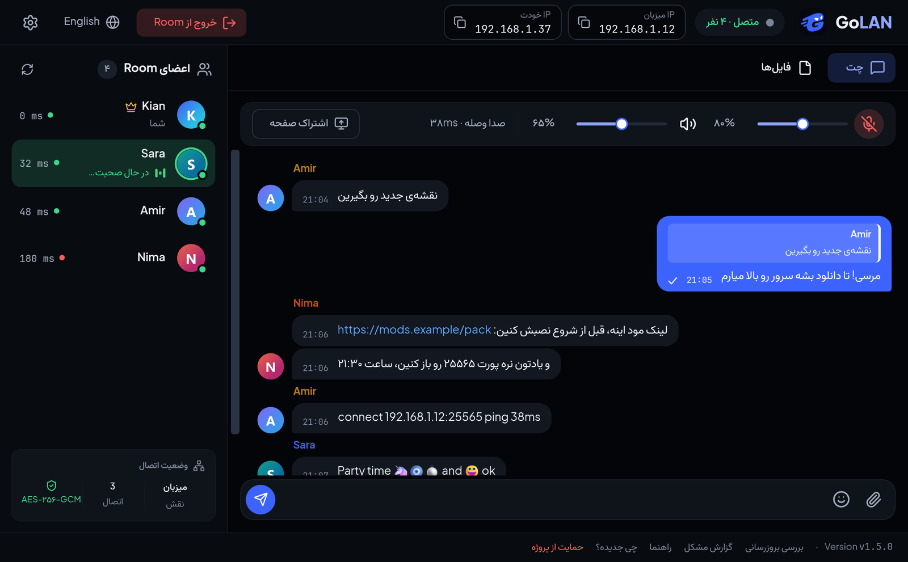

</div>

---

## GoLAN چیست؟

GoLAN چند کامپیوتر را روی اینترنت طوری به هم وصل می‌کند که انگار همه روی یک **شبکه‌ی محلی واقعی** نشسته‌اند. برای این کار یک آداپتور شبکه‌ی مجازی روی ویندوز می‌سازد — با درایور هسته‌ای [WinTun](https://www.wintun.net/) که پشت WireGuard هم هست — پس هر بازی یا برنامه‌ای که دنبال بازی‌های LAN می‌گردد، همین شبکه را می‌بیند.

کنار شبکه، یک **اتاق کامل** هم داخل خودِ برنامه هست: چت، تماس صوتی با حذف نویز، اشتراک صفحه (با صدا) و انتقال فایل مستقیم — همه روی همان یک اتصال رمزنگاری‌شده. لازم نیست هم‌زمان دیسکورد یا برنامه‌ی دیگری باز باشد.

و برای وصل شدن؟ میزبان یک **کد کوتاه** (مثل `X234FGH`) می‌گیرد و برای دوستانش می‌فرستد. همین. GoLAN برای استفاده‌ی شخصی **رایگان** است.

<div align="center">

|  🎮 **بدون سرور** | 🔑 **ورود با یک کد** | 🔒 **رمزنگاری سرتاسری** | 🇮🇷 **فارسی و راست‌به‌چپ** |
|:---:|:---:|:---:|:---:|
| میزبان یکی از خود بازیکن‌هاست؛ چیزی از سرور رد نمی‌شود | کد هفت‌حرفی به‌جای IP و پورت؛ با ابزارهای شبکه‌ی مجازی دیگر هم کار می‌کند | کلید تازه برای هر نشست، مثل Signal | رابط، فونت و ارقام برای فارسی ساخته شده |

</div>

### برای چه کاری؟

<div align="center">

| 🎮 بازی کنید | 💬 صحبت کنید | 📁 فایل بفرستید |
|:---|:---|:---|
| بازی‌هایی که فقط «LAN» دارند را با دوستان دور از هم بازی کنید؛ همه روی یک شبکه‌ی مجازی‌اند و پینگ هر نفر دیده می‌شود. | چت با ایموجی سه‌بعدی، تماس صوتی بدون نویز و اشتراک صفحه، بدون برنامه‌ی دوم. | تا ۶۴ گیگابایت، مستقیم و هم‌زمان برای چند نفر، با تأیید SHA-256. |

</div>

---

## 🖼️ نگاهی به برنامه

<div align="center">

<table>
<tr>
<td align="center" width="50%">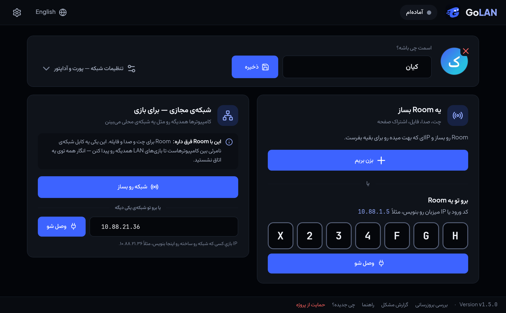<br><sub><b>لابی</b> — اسم، «یه Room بساز»، «شبکه رو بساز» و ورود با کد</sub></td>
<td align="center" width="50%">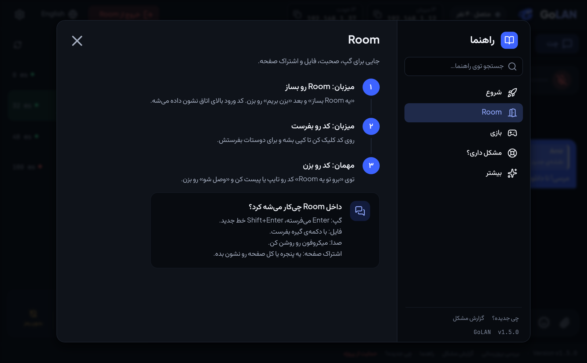<br><sub><b>راهنمای درون‌برنامه</b> — کلید <code>F1</code>، با جستجو</sub></td>
</tr>
<tr>
<td align="center" width="50%">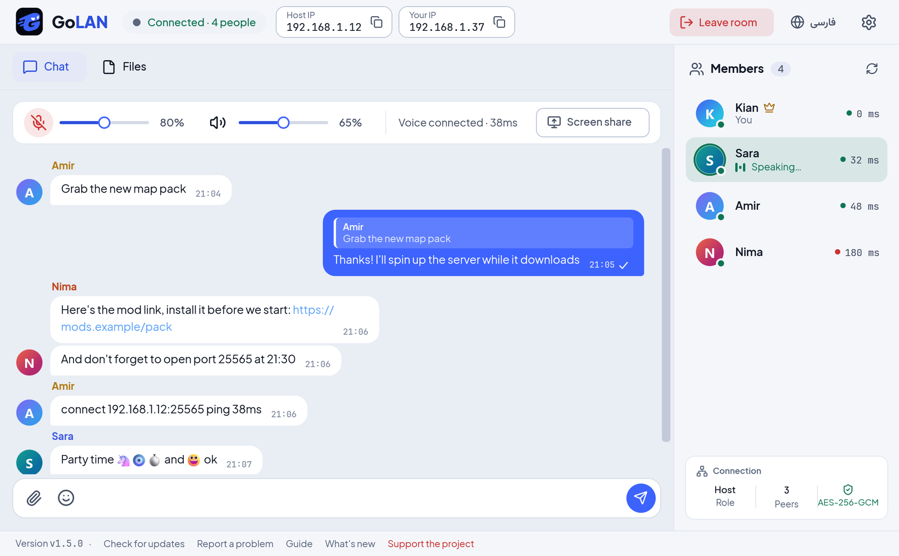<br><sub><b>Room</b> — تم روشن، به انگلیسی</sub></td>
<td align="center" width="50%">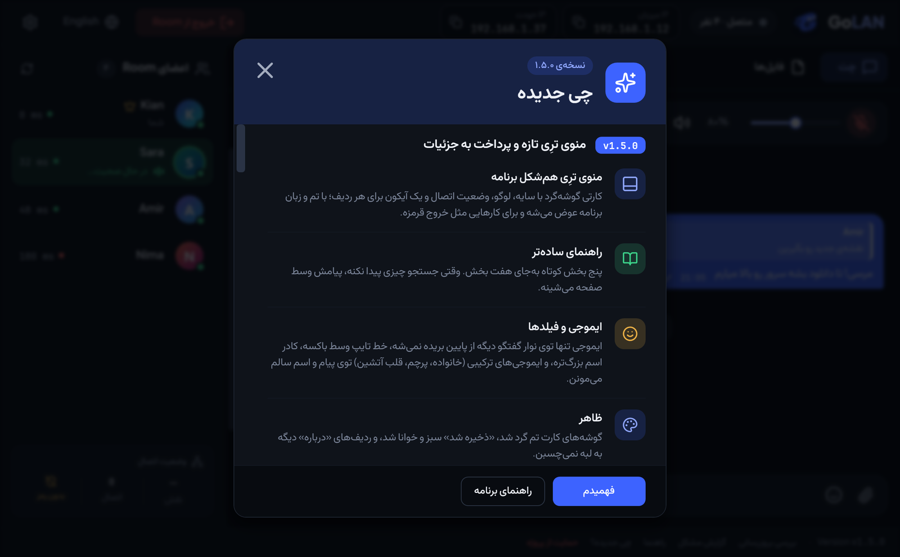<br><sub><b>«چی جدیده؟»</b> — یادداشت مخصوص هر نسخه</sub></td>
</tr>
<tr>
<td align="center" width="50%">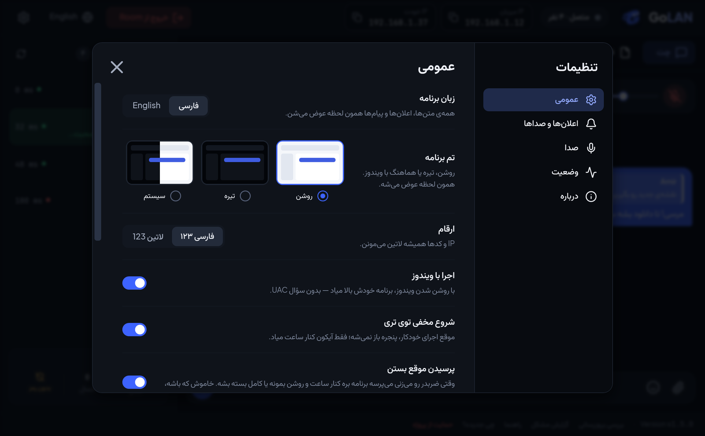<br><sub><b>تنظیمات</b> — زبان، تم، ارقام، عکس پروفایل</sub></td>
<td align="center" width="50%">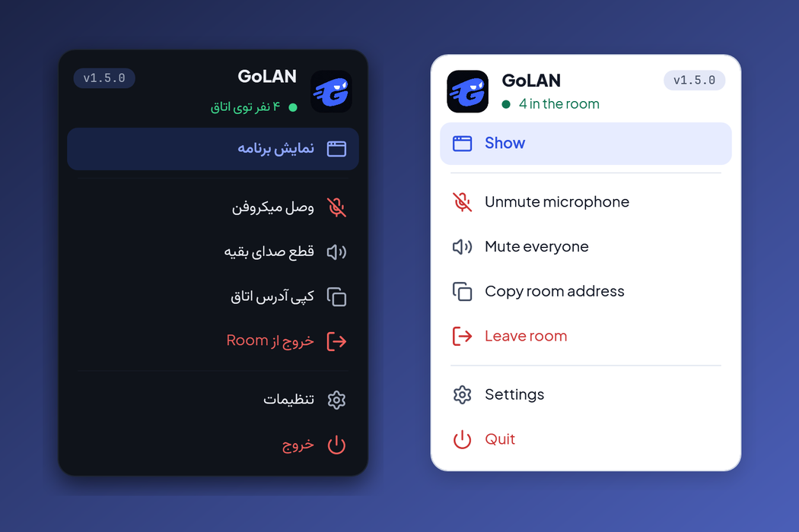<br><sub><b>منوی ترِی</b> — هم‌شکل خود برنامه، با تم و زبان عوض می‌شود</sub></td>
</tr>
</table>

</div>

---

<a id="نصب-و-شروع-سریع"></a>
## 🚀 نصب و شروع سریع

1. **دانلود:** از **[صفحه‌ی ریلیز](https://github.com/parhamzare139/VirtualLANPlatform/releases/latest)** فایل `GoLAN_Setup_*.exe` را بگیرید و اجرا کنید.
2. **دسترسی ادمین:** یک‌بار تأیید کنید — فقط برای نصب درایور آداپتور مجازی و یک قانون فایروال مخصوص همان آداپتور لازم است.
3. **ساخت:** اسمتان را بنویسید و یکی را بزنید:
   - **«یه Room بساز»** برای چت، صدا، فایل و اشتراک صفحه — یک **کد ورود** کوتاه (مثل `X234FGH`) بالای اتاق نشان داده می‌شود؛ با یک کلیک کپی می‌شود.
   - **«شبکه رو بساز»** برای بازی — یک **IP بازی** (مثل `10.88.21.36`) به شما داده می‌شود؛ همان که توی بازی هم استفاده می‌کنید.
4. **ورود:** کد یا IP را برای دوستانتان بفرستید. آن‌ها فقط همان را در «برو تو یه Room» یا «یا برو تو شبکه‌ی یکی دیگه» می‌زنند و وصل می‌شوند.
5. **بازی:** در بازی گزینه‌ی LAN یا «اتصال با IP» را بزنید و IP میزبان را بدهید.

> 💡 هر جا گیر کردید، کلید **`F1`** راهنمای داخل برنامه را باز می‌کند — با جستجو و جواب مشکل‌های رایج.

<div align="center">

| نیازمندی | مقدار |
|---|---|
| سیستم‌عامل | ویندوز ۱۰ (نسخه ۱۸۰۹ به بعد) یا ویندوز ۱۱، فقط ۶۴ بیتی |
| Runtime | .NET 8 Desktop Runtime — اگر نصب نباشد، خودِ نصب‌کننده دانلودش می‌کند |
| دسترسی | ادمین، یک‌بار برای درایور آداپتور مجازی |
| پورت‌ها | UDP ‏**۴۲۷۷۷** (اتاق) و **۴۲۷۷۸** (شبکه‌ی مجازی) — فقط روی میزبان |

</div>

برای تأیید فایل نصب (اختیاری)، هش SHA-256 هر نسخه در صفحه‌ی ریلیز آمده است:

```powershell
(Get-FileHash GoLAN_Setup_*.exe -Algorithm SHA256).Hash
```

---

<a id="ویژگیها"></a>
## ✨ ویژگی‌ها

### 🎮 شبکه‌ی مجازی

| | |
|---|---|
| **آداپتور واقعی** | یک کارت شبکه‌ی مجازی روی ویندوز (WinTun)؛ بازی‌ها و برنامه‌های LAN-only آن را مثل شبکه‌ی خانگی می‌بینند. |
| **یک IP برای همه‌چیز** | میزبان یک IP ثابت `10.88.x.y` دارد؛ همان IP هم در بازی استفاده می‌شود هم برای وصل شدن مهمان‌ها. دو عدد جدا لازم نیست. |
| **توپولوژی ستاره‌ای** | یک میزبان و چند مهمان. فقط میزبان به پورت باز نیاز دارد؛ ترافیک بین مهمان‌ها از او رله می‌شود. |
| **پینگ و کیفیت هر نفر** | پینگ، کیفیت، آپلود، دانلود و درصد پکت گم‌شده‌ی هر عضو، زنده در لیست اعضا. |
| **پورت خودکار** | تشخیص NAT با UPnP و STUN، از جمله تشخیص NAT اپراتوری (CGNAT) که باز کردن پورت را اصلاً ممکن نمی‌کند — و راهنمای قدم‌به‌قدم وقتی دستی لازم باشد. |
| **پایدارساز شبکه** | روی خطی که واقعاً پکت گم می‌کند، بسته‌های کوچک بازی و صدا دوبار فرستاده می‌شوند تا قطعی حس نشود. |
| **جلوگیری از جعل** | میزبان پکتی را که آدرس مبدأش جعلی باشد دور می‌ریزد. |

### 🔑 ورود با کد

به‌جای IP و پورت، یک **کد هفت‌حرفی** (حروف و عدد، مثل `X234FGH`) بدهید.

- **Room:** کد تصادفی است و بالای اتاق، کنار IP ها نشان داده می‌شود. مهمان کد را در هفت جعبه‌ی بزرگ می‌زند (مثل صفحه‌ی کد تأیید)؛ چسباندن کل پیام دعوت هم کار می‌کند.
- **شبکه‌ی مجازی:** «کد» همان IP ثابت بازی (`10.88.x.y`) است.
- **با ابزارهای دیگر هم کار می‌کند:** کد همه‌ی آدرس‌های میزبان را در بر دارد (شبکه‌ی مجازی، کارت LAN، اینترنت) و برنامه یکی‌یکی، از نزدیک‌ترین، امتحانشان می‌کند. پس برای کسانی که با PacketRaft و ابزارهای مشابه به هم وصل‌اند هم کار می‌کند.
- **آدرس قدیمی هم هنوز کار می‌کند** (IP و پورت).

> 🔐 **حریم خصوصی:** فقط آدرس میزبان (از جمله IP عمومی‌اش) و کد روی یک سرویس کوچک نگه داشته می‌شود؛ بعد از بستن Room پاک می‌شود و بدون تمدید بعد از **۳۰ دقیقه** خودش منقضی می‌شود. اسم، پیام و فایل هیچ‌وقت به آن نمی‌رسد.

### 💬 اتاق: چت، صدا، صفحه، فایل

- **چت** با مجموعه‌ی کامل **ایموجی سه‌بعدی**، ریپلای، حذف پیام (فقط برای نویسنده‌اش) و پیش‌نمایش عکس و لینک
- **عکس پروفایل** با کراپ و زوم؛ در لیست اعضا و کنار پیام هر نفر نمایش داده می‌شود، مثل تلگرام
- **تیک دیده‌شدن** — تیک دوم فقط وقتی می‌خورد که پیام واقعاً روی صفحه‌ی طرف مقابل بوده باشد، و «داره می‌نویسه…» هم هست
- **صدای زنده** روی Opus، با حذف نویز طیفی، تنظیم خودکار بلندی و بازسازی پکت‌های گم‌شده؛ با عوض شدن هدفون، صدا خودکار می‌رود روی آن
- **Push-to-talk** با کلید دلخواه، و نشانگر «در حال صحبت» کنار اسم هر نفر
- **اشتراک صفحه** (یک پنجره یا کل صفحه) **همراه با صدای سیستم**
- **انتقال فایل** مستقیم تا **۶۴ گیگابایت**، هم‌زمان به چند نفر — حتی اگر یکی دیر قبول کند — با تأیید SHA-256
- **وضعیت** هر نفر: آنلاین، در بازی (وقتی برنامه‌ی تمام‌صفحه باز است) یا دور از سیستم

### 🔒 امنیت

- **ECDH P-256 + AES-256-GCM** برای هر اتصال، با کلید جدا برای هر جهت و کلید تازه در هر نشست
- **کد امنیتی** قابل مقایسه بین دو طرف — همان سازوکاری که Signal و واتس‌اپ برای تشخیص حمله‌ی مرد میانی دارند
- هویت فرستنده از روی **خودِ اتصال** تعیین می‌شود، نه از محتوای پیام؛ پس کسی نمی‌تواند به اسم دیگری پیام بدهد یا پیام او را پاک کند
- پنجره‌ی ضد replay، و پاک‌سازی نام فایل، اسم و پیام (از جمله کاراکتری که پسوند `.exe` را شبیه `.jpg` نشان می‌دهد)
- فایل‌های دریافتی مثل دانلود از اینترنت علامت می‌خورند تا ویندوز پیش از اجرا هشدار بدهد
- به‌روزرسانی فقط از GitHub روی TLS و با تأیید **SHA-256** پیش از اجرا

### 🎨 تجربه‌ی کاربری

- **فارسی (راست‌به‌چپ) و انگلیسی**، با تم تیره‌ی سیاه، تم روشن، یا هماهنگ با ویندوز
- **راهنمای درون‌برنامه** با جستجو (کلید `F1`): پنج بخش کوتاه، مراحل شماره‌دار و جواب مشکل‌های رایج
- **«چی جدیده؟»** مخصوص هر نسخه؛ اگر چند نسخه عقب بوده باشید بعد از به‌روزرسانی همه‌ی نسخه‌های جاافتاده را یکجا می‌بینید
- **منوی ترِی هم‌شکل برنامه** — کارت گوشه‌گرد با وضعیت اتصال، میکروفون و بلندگو، کپی آدرس و خروج؛ برنامه با روشن شدن ویندوز بی‌صدا توی ترِی بالا می‌آید
- **ارقام فارسی یا لاتین به انتخاب خودتان** — IP، پورت و کدها همیشه لاتین می‌مانند و نقطه‌ها هیچ‌وقت خراب نمی‌شوند؛ زبان ویندوز هم روی ظاهر برنامه اثری ندارد
- **فونت‌ها داخل خود برنامه‌اند** (Plus Jakarta Sans، Vazirmatn، JetBrains Mono)؛ روی هر سیستمی یک‌شکل دیده می‌شود
- انیمیشن‌های نرم و بلور ملایم پشت دیالوگ‌ها
- صدای اعلان قابل شخصی‌سازی — صدای خودتان را جای هر کدام بگذارید

<div align="center">

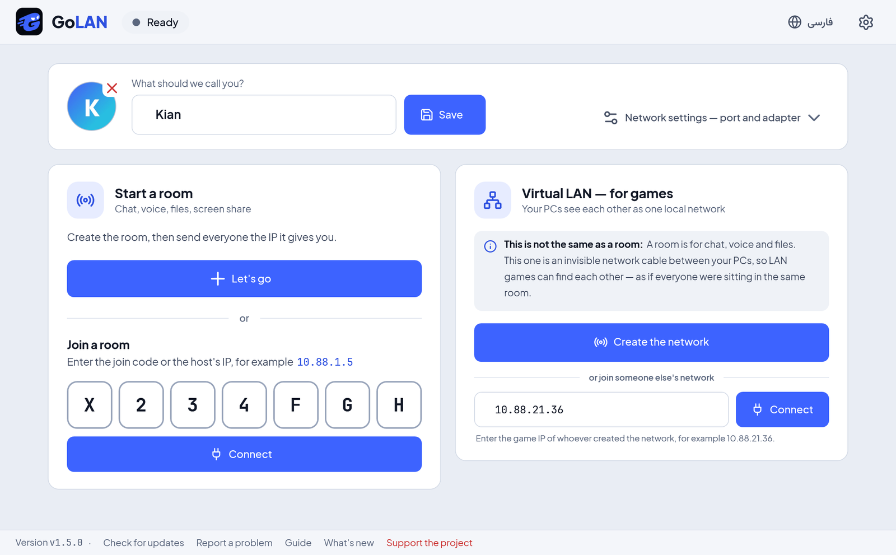&nbsp;&nbsp;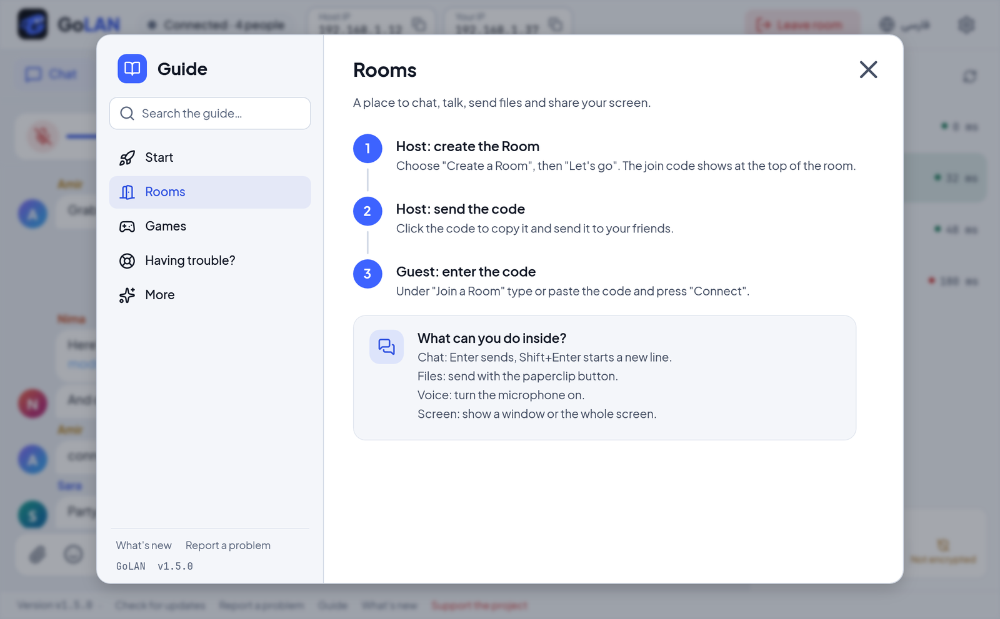

<sub>تم روشن و رابط انگلیسی — لابی و راهنمای درون‌برنامه</sub>

</div>

---

## ⌨️ میانبرها

<div align="center">

| کلید | کار |
|:---:|---|
| `F1` | باز و بسته کردن راهنما |
| `Esc` | بستن پنجره‌ی باز (راهنما، تنظیمات، چی جدیده)، یا لغو پاسخ دادن |
| `Enter` | فرستادن پیام |
| `Shift` + `Enter` | خط جدید |
| کلید دلخواه | Push-to-talk (تنظیمات ← صدا) — توی بازی هم کار می‌کند |

</div>

---

<a id="چطور-کار-میکند"></a>
## 🧭 چطور کار می‌کند

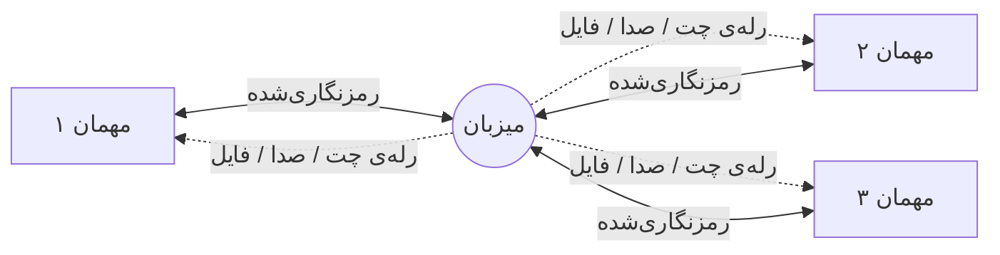

هر مهمان فقط **یک** اتصال مستقیم به میزبان دارد و کلید رمزنگاری‌اش هم مخصوص همان اتصال است. پیام یا صدایی که باید به همه برسد از میزبان رله می‌شود — بی‌آنکه میزبان بتواند جای کسی وانمود کند، چون هویت هر پیام از اتصالی که از آن آمده تعیین می‌شود.

میزبان روی پورت‌های بالا گوش می‌دهد. برنامه با UPnP تلاش می‌کند آن‌ها را خودش روی روتر باز کند؛ اگر نشد، راهنمای باز کردن دستی را نشان می‌دهد و با STUN تشخیص می‌دهد که اصلاً پشت NAT اپراتور هستید یا نه.

### ورود با کد، قدم‌به‌قدم

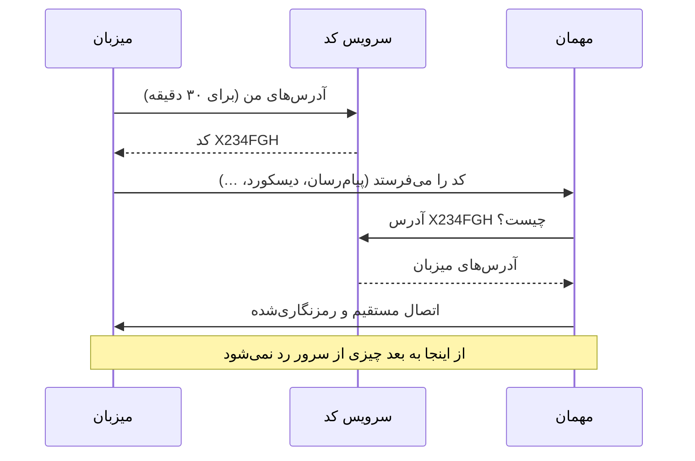

---

<a id="امنیت-و-حریم-خصوصی"></a>
## 🔐 امنیت و حریم خصوصی

<div align="center">

| نگرانی | پاسخ |
|---|---|
| «کسی چت یا صدایم را می‌بیند؟» | همه‌ی ترافیک با کلیدی رمزنگاری می‌شود که مخصوص همان یک نشست است. هیچ سرور میانی‌ای وجود ندارد که چیزی از آن رد شود. |
| «سرویس کد چه چیزی از من می‌داند؟» | فقط آدرس میزبان و کد تصادفی، حداکثر ۳۰ دقیقه و تا وقتی Room بازه. اسم، پیام و فایل هیچ‌وقت به آن نمی‌رسد. |
| «اگر یک نشست لو برود؟» | کلید هر نشست تازه است (ECDH)؛ لو رفتن یکی روی نشست‌های قبل و بعد اثری ندارد. |
| «مرد میانی؟» | کد امنیتی کوتاه به هر دو طرف نشان داده می‌شود تا از راه دیگری (مثلاً صدا) مقایسه کنند. |
| «کسی به اسم من پیام بدهد؟» | هویت از اتصال می‌آید، نه از متن پیام؛ جعل یا حذف پیام دیگران ممکن نیست. |
| «فایل مخرب؟» | نام فایل پاک‌سازی می‌شود، فایل با علامت «از اینترنت» ذخیره می‌شود و ویندوز پیش از اجرا هشدار می‌دهد. فایل فقط وقتی ذخیره می‌شود که قبول کنید. |
| «به‌روزرسانی جعلی؟» | فقط از GitHub روی TLS، و پیش از اجرا با SHA-256 اعلام‌شده تأیید می‌شود؛ فایلی که با آن نخواند نصب نمی‌شود. |
| «عکس پروفایلم؟» | فقط برای اعضای همان اتاق فرستاده می‌شود و با خروج از اتاق از حافظه‌ی بقیه پاک می‌شود. |
| «چه چیزی روی سیستم من می‌ماند؟» | تنظیمات، لاگ‌ها و عکس پروفایل در `%LOCALAPPDATA%\GoLAN` — و فقط با خواست خودتان («گزارش مشکل») در یک فایل zip جمع می‌شوند. |

</div>

---

<a id="tech-stack"></a>
## 🛠️ زیر کاپوت

<div align="center">

| لایه | فناوری |
|---|---|
| رابط کاربری | WPF روی .NET 8 |
| شبکه | [LiteNetLib](https://github.com/RevenantX/LiteNetLib) (UDP) + [WinTun](https://www.wintun.net/) برای آداپتور مجازی |
| صدا | Opus (از طریق Concentus) + NAudio |
| رمزنگاری | ECDH P-256 · AES-256-GCM · HKDF — پیاده‌سازی خودِ .NET |
| ذخیره‌سازی محلی | SQLite |
| کد ورود | یک سرویس کوچک روی Cloudflare Workers که فقط آدرس میزبان را ۳۰ دقیقه نگه می‌دارد |

</div>

---

## 🕘 تاریخچه‌ی نسخه‌ها

متن کامل هر نسخه در **[صفحه‌ی ریلیزها](https://github.com/parhamzare139/VirtualLANPlatform/releases)** هست؛ خلاصه:

<div align="center">

| نسخه | چه چیزی آمد |
|:---:|---|
| **۱.۵.۰** | منوی ترِی هم‌شکل برنامه، راهنمای ساده‌تر، ایموجی ترکیبی سالم، اصلاح خط‌چین دور دکمه‌ها و فیلدها، باز شدن فوری تنظیمات |
| **۱.۴.۰** | راهنمای درون‌برنامه با جستجو (`F1`) و «چی جدیده؟» مخصوص هر نسخه |
| **۱.۳.x** | ورود با کد؛ یک IP برای شبکه‌ی مجازی؛ کادر کد به شکل هفت جعبه؛ عکس‌ها در فارسی برعکس نمی‌شوند |
| **۱.۲.x** | اسم و ظاهر GoLAN؛ عکس پروفایل؛ مجموعه‌ی کامل ایموجی سه‌بعدی؛ صدای اشتراک صفحه؛ ترِی بهتر |
| **۱.۱.۰** | صدای بازنویسی‌شده، اتصال پایدارتر، تیک دوم پیام، ارسال فایل برای چند نفر، امنیت بیشتر |

</div>

---

<a id="سوالات-متداول"></a>
## ❓ سوالات متداول

<details>
<summary>چرا برنامه به دسترسی ادمین نیاز دارد؟</summary><br>

برای نصب درایور آداپتور شبکه‌ی مجازی (WinTun) و اضافه کردن یک قانون فایروال مخصوص همان آداپتور. این کار فقط یک‌بار، موقع اولین اجراست.
</details>

<details>
<summary>کد ورود یا IP کار نمی‌کند («به میزبان نرسیدم»)</summary><br>

تقریباً هیچ‌وقت مشکل از کد نیست. به ترتیب چک کنید: Room هنوز باز باشد؛ کد کامل (هفت حرف) تایپ شده باشد؛ فایروال ویندوز اگر پرسید «اجازه بده» را بزنید؛ مودم میزبان UPnP داشته باشد (یا پورت UDP ‏۴۲۷۷۷ / ۴۲۷۷۸ دستی باز شود — راهنمای UPnP داخل برنامه قدم‌به‌قدم نشان می‌دهد). اگر اینترنت میزبان CGNAT باشد (چند خانه یک IP)، از بیرون نمی‌شود به او رسید؛ با یک ابزار شبکه‌ی مجازی مثل PacketRaft وصل شوید، یا نفر دیگری میزبان شود.
</details>

<details>
<summary>«این کد پیدا نشد» می‌گوید</summary><br>

میزبان Room را بسته، یا کد بعد از ۳۰ دقیقه بدون تمدید منقضی شده. از میزبان یک کد تازه بگیرید. پیدا کردن کد به اینترنت نیاز دارد؛ اگر فقط روی یک شبکه‌ی محلی هستید، به‌جایش IP میزبان را بزنید.
</details>

<details>
<summary>بازی شبکه‌ی مجازی را نمی‌بیند</summary><br>

بعضی بازی‌ها لیست خودکار نشان نمی‌دهند و فقط با IP وصل می‌شوند: «LAN» یا «اتصال با IP» را بزنید و IP بازی میزبان (`10.88.x.y`) را بدهید. شبکه‌ی تازه‌ی ویندوز باید «خصوصی» باشد، و فایروال برای خودِ بازی باز.
</details>

<details>
<summary>اسم برنامه چرا عوض شد؟ نسخه‌ی قبلی هنوز کار می‌کند؟</summary><br>

GoLAN همان Virtual LAN Platform است با اسم و ظاهر جدید. نسخه‌های ۱.۱ به بعد با هم وصل می‌شوند و نصب جدید روی نسخه‌ی قبلی، تنظیمات شما را نگه می‌دارد.
</details>

<details>
<summary>آیا جایگزین Hamachi یا Radmin VPN است؟</summary><br>

از نظر کاربرد — ساختن یک LAN مجازی برای بازی‌های قدیمی — هدف مشابهی دارد. چت، صدا، اشتراک صفحه و انتقال فایل داخلی و رمزنگاری‌شده، بخش اضافه‌ای است که کنارش می‌آید. و اگر کسی با ابزار شبکه‌ی مجازی دیگری (مثل PacketRaft) وصل است، کد ورود برای او هم کار می‌کند.
</details>

<details>
<summary>روی مک یا لینوکس کار می‌کند؟</summary><br>

فعلاً نه — به‌خاطر درایور WinTun و رابط WPF، فقط ویندوز ۱۰ (۱۸۰۹ به بعد) و ۱۱، هر دو ۶۴ بیتی.
</details>

<details>
<summary>چطور عکس پروفایل بگذارم؟</summary><br>

روی دایره‌ی عکس توی لابی کلیک کنید (یا تنظیمات ← عمومی ← عکس پروفایل)، عکس را انتخاب کنید، در پنجره‌ی گرد جابه‌جا و بزرگ و کوچکش کنید و ذخیره بزنید. دیگران وقتی می‌بینند که میزبان اتاق هم از نسخه‌ی ۱.۲ به بعد باشد.
</details>

<details>
<summary>آپدیت «نصب ناموفق» می‌دهد</summary><br>

برنامه هر فایل به‌روزرسانی را با اثر انگشتش (SHA-256) می‌سنجد و اگر با لیست نخواند قبول نمی‌کند؛ این برای امنیت خودتان است. یک بار دیگر امتحان کنید، و اگر نشد آخرین `GoLAN_Setup_*.exe` را دستی از صفحه‌ی ریلیز بگیرید و اجرا کنید؛ اسم و تنظیماتتان می‌ماند.
</details>

<details>
<summary>سورس باز است؟</summary><br>

نه؛ رایگان برای استفاده‌ی شخصی است، ولی سورس بسته است و مالکیت آن نزد نویسنده می‌ماند. جزئیات در <a href="LICENSE">LICENSE</a>.
</details>

<details>
<summary>چطور بفهمم آخرین نسخه را دارم؟</summary><br>

برنامه هنگام باز شدن (و از تنظیمات ← درباره، هر وقت بخواهید) نسخه‌ی جدید را بررسی می‌کند و اگر بود، دانلود و نصبش را قدم‌به‌قدم پیش می‌برد.
</details>

---

<a id="پشتیبانی-و-گزارش-مشکل"></a>
## 🛟 پشتیبانی و گزارش مشکل

- **داخل برنامه:** «گزارش مشکل» پایین پنجره (یا تنظیمات ← درباره) — ایمیل پشتیبانی را برایتان کپی می‌کند و اگر خواستید، لاگ‌ها و مشخصات شبکه‌تان را در یک فایل zip ذخیره می‌کند. چیزی بدون اجازه‌ی شما نمی‌رود.
- **ایمیل:** [vlanplat.help@gmail.com](mailto:vlanplat.help@gmail.com)
- **گزارش باگ عمومی:** [GitHub Issues](https://github.com/parhamzare139/VirtualLANPlatform/issues)
- اگر برنامه به کارتان آمد و خواستید حمایت کنید: **[reymit.ir/vlanplatform](https://reymit.ir/vlanplatform)**

---

## 📜 مجوز

**Proprietary Freeware** — رایگان برای استفاده‌ی شخصی و غیرتجاری؛ سورس‌کد باز نیست و کپی، تغییر یا توزیع مجدد سورس مجاز نیست. توزیع خودِ فایل نصب/اجرایی بدون تغییر آزاد است. متن کامل: **[LICENSE](LICENSE)**.

## 🙏 با تشکر از

- **[WinTun](https://www.wintun.net/)** (پروژه‌ی WireGuard) — MIT License
- **[Vazirmatn](https://github.com/rastikerdar/vazirmatn)** — SIL Open Font License، برای متن و ارقام فارسی
- **[Plus Jakarta Sans](https://github.com/tokotype/PlusJakartaSans)** و **[JetBrains Mono](https://github.com/JetBrains/JetBrainsMono)** — SIL Open Font License، برای متن لاتین و IPها
- **[Fluent Emoji](https://github.com/microsoft/fluentui-emoji)** (Microsoft) از طریق **[fluent-emoji](https://github.com/bignutty/fluent-emoji)** (bignutty) — MIT License، برای ایموجی سه‌بعدی
- **[Lucide](https://lucide.dev/)** — ISC License، برای آیکون‌ها؛ **[LiteNetLib](https://github.com/RevenantX/LiteNetLib)**، **[NAudio](https://github.com/naudio/NAudio)**، **[Concentus](https://github.com/lostromb/concentus)** — هر کدام با مجوز متن‌باز خودشان

<div align="center">
<sub>ساخته‌شده برای بازی و کار گروهی؛ بدون سرور، بدون پیچیدگی.</sub>
</div>

---
---

<a id="-english"></a>
# 🇬🇧 English

<div align="center">

**A peer-to-peer virtual LAN for gaming, chat, voice and file sharing — no server, no router setup.**


</div>

## What is GoLAN?

GoLAN (formerly Virtual LAN Platform) creates a real virtual network adapter on Windows — using [WinTun](https://www.wintun.net/), the same kernel driver behind WireGuard — and links several computers over the internet as if they were on one physical LAN. Any game or application that looks for a local network sees this one: there is no central server and no manual port forwarding for anyone except the host.

Alongside the network, the app carries its own room: text chat, noise-suppressed voice calls, screen sharing (with sound) and direct peer-to-peer file transfer, all over the same encrypted connection.

And to join? The host gets a **short code** (like `X234FGH`) and sends it to friends. That's it. GoLAN is **free** for personal use.

<div align="center">

|  🎮 **No server** | 🔑 **One code to join** | 🔒 **End-to-end encrypted** | 🇮🇷 **Persian & English** |
|:---:|:---:|:---:|:---:|
| The host is one of the players; nothing passes through a server | A seven-character code instead of IP and port; works for people on other virtual-LAN tools too | A fresh key every session, like Signal | Built for right-to-left from the start |

</div>

### What is it for?

<div align="center">

| 🎮 Play | 💬 Talk | 📁 Send files |
|:---|:---|:---|
| Play games that only have "LAN" mode with friends far away. Everyone is on one virtual network and each person's ping is on screen. | Chat with 3D emoji, noise-free voice calls and screen sharing — without a second app. | Up to 64 GB, direct, to several people at once, SHA-256 verified. |

</div>

## 🖼️ A look at the app

<div align="center">

<table>
<tr>
<td align="center" width="50%"><br><sub><b>The lobby</b> — your name, "Start a room", "Create the network", join with a code</sub></td>
<td align="center" width="50%"><br><sub><b>The in-app guide</b> — <code>F1</code>, with search</sub></td>
</tr>
<tr>
<td align="center" width="50%"><br><sub><b>The room</b> — dark theme, Persian</sub></td>
<td align="center" width="50%">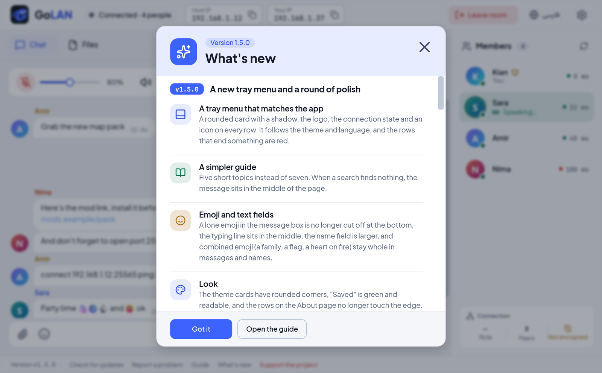<br><sub><b>What's new</b> — notes for every version</sub></td>
</tr>
<tr>
<td align="center" width="50%">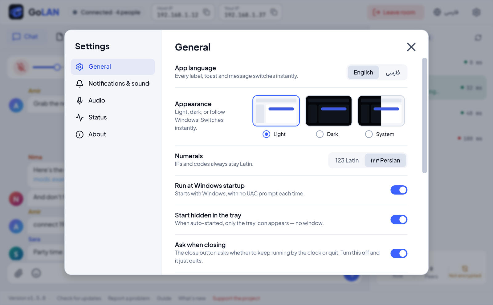<br><sub><b>Settings</b> — language, theme, digits, profile picture</sub></td>
<td align="center" width="50%"><br><sub><b>The tray menu</b> — matches the app, follows theme and language</sub></td>
</tr>
</table>

</div>

## 🚀 Quick start

1. Download `GoLAN_Setup_*.exe` from the **[latest release](https://github.com/parhamzare139/VirtualLANPlatform/releases/latest)** and run it.
2. Grant administrator access once — only to install the virtual adapter driver and its firewall rule.
3. Type your name, then pick one:
   - **"Start a room"** for chat, voice, files and screen sharing — a short **join code** (like `X234FGH`) shows at the top of the room; click it to copy.
   - **"Create the network"** for games — you get a **game IP** (like `10.88.21.36`), the same one you use inside the game.
4. Send the code or IP to your friends. They type just that under "Join a room" or "Or join someone else's network".
5. In the game choose LAN or "connect by IP" and enter the host's IP.

> 💡 Stuck? Press **`F1`** for the in-app guide, with search and answers to the usual problems.

| Requirement | Value |
|---|---|
| OS | Windows 10 (1809+) or Windows 11, 64-bit only |
| Runtime | .NET 8 Desktop Runtime — installed automatically if missing |
| Access | Administrator, once, for the virtual adapter |
| Ports (host only) | UDP **42777** (room) and **42778** (virtual network) |

To verify the installer (optional), each release lists its SHA-256:

```powershell
(Get-FileHash GoLAN_Setup_*.exe -Algorithm SHA256).Hash
```

## ✨ Features

### 🎮 Virtual LAN

- **A real adapter** — a virtual network card on Windows (WinTun); LAN-only games and apps see it like a home network.
- **One IP for everything** — the host has a fixed `10.88.x.y` address, used both in the game and by guests to join.
- **Star topology** — one host, several guests; only the host needs an open port, and traffic between guests is relayed through it.
- **Ping and quality per person** — ping, quality, upload, download and packet loss, live in the member list.
- **Automatic ports** — NAT detection through UPnP and STUN, including carrier-grade NAT (CGNAT) where opening a port is impossible, with a step-by-step guide when it must be done by hand.
- **Network stabiliser** — on a line that genuinely loses packets, small game and voice packets are sent twice so drops are not felt.
- **Spoof protection** — the host drops packets whose source address is forged.

### 🔑 Join codes

Give a **seven-character code** (letters and digits, like `X234FGH`) instead of an IP and port.

- **Rooms:** the code is random and shown at the top of the room beside the IPs. Guests type it into seven large boxes (like a verification-code screen); pasting a whole invite message works too.
- **Virtual network:** the "code" is the fixed game IP (`10.88.x.y`).
- **Works with other tools:** a code carries all the host's addresses (virtual network, LAN card, internet) and the app tries them one by one, nearest first — so it also works for people on PacketRaft and similar tools.
- **Plain addresses still work** (IP and port).

> 🔐 **Privacy:** only the host's addresses (including its public IP) and the code are kept on a tiny service; they are removed when the room closes and expire after **30 minutes** without renewal. No name, message or file ever goes there.

### 💬 The room: chat, voice, screen, files

- **Chat** with the full **3D emoji** set, replies, author-only delete, image and link previews
- **Profile pictures** with crop and zoom, shown in the member list and beside each person's messages, like Telegram
- **Read receipts** — the second tick only when the message has actually been on the other person's screen — and "is typing…"
- **Live voice** over Opus with spectral noise suppression, automatic gain and loss concealment; plug in a headset and the call moves to it
- **Push-to-talk** with a key of your choice, and a "speaking" indicator by each name
- **Screen sharing** (a window or the whole screen) **with the system sound**
- **File transfer** direct, up to **64 GB**, to several people at once — even if one accepts late — SHA-256 verified
- **Status** for everyone: online, in game (when a full-screen app is open) or away

### 🔒 Security

- **ECDH P-256 + AES-256-GCM** per connection, with a separate key per direction and a fresh key every session
- A comparable **safety code** — the mechanism Signal and WhatsApp use against man-in-the-middle attacks
- Sender identity comes from the **connection itself**, never from the message, so nobody can post as someone else or delete another person's message
- Replay protection, and sanitising of file names, names and messages (including the RTL-override trick that disguises `.exe` as `.jpg`)
- Received files are marked as from the internet, so Windows warns before they run
- Updates come only from GitHub over TLS and are verified against a **SHA-256** hash before they run

### 🎨 Interface

- **Persian (right-to-left) and English**, with a near-black dark theme, a light one, or follow Windows
- **An in-app guide** with search (`F1`): five short topics, numbered steps and answers to the usual problems
- **"What's new" for every version** — if you were several versions behind, you see every version you missed after updating
- **A tray menu that matches the app** — a rounded card with the connection state, microphone and speaker, copy address and quit; the app starts silently in the tray with Windows
- **Persian or Latin digits, your choice** — IPs, ports and codes always stay Latin and dots never break; the Windows language has no effect on how the app looks
- **Bundled fonts** (Plus Jakarta Sans, Vazirmatn, JetBrains Mono), so it looks identical everywhere
- Smooth motion and a gentle blur behind dialogs
- Customisable notification sounds — use your own recording for any of them

## ⌨️ Shortcuts

| Key | Does |
|:---:|---|
| `F1` | Open or close the guide |
| `Esc` | Close the open window (guide, settings, what's new), or cancel a reply |
| `Enter` | Send the message |
| `Shift` + `Enter` | New line |
| your key | Push-to-talk (Settings → Audio) — works inside games too |

## 🧭 How it works

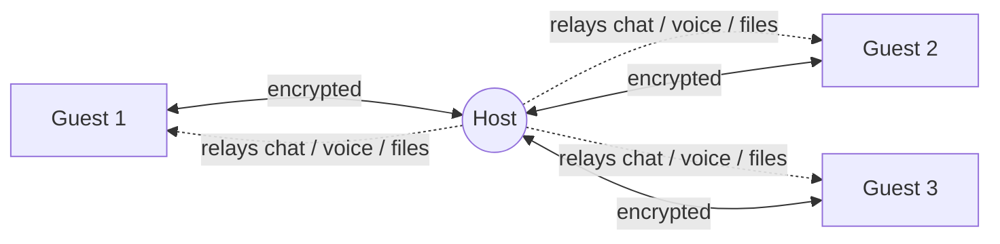

Each guest has just **one** direct connection to the host, with an encryption key that belongs to that connection alone. A message or voice that must reach everyone is relayed by the host — without the host being able to impersonate anyone, because the identity of every message comes from the connection it arrived on.

The host listens on the ports above. The app tries to open them on the router with UPnP; if that fails it shows the manual guide, and STUN tells whether you are behind a carrier's NAT at all.

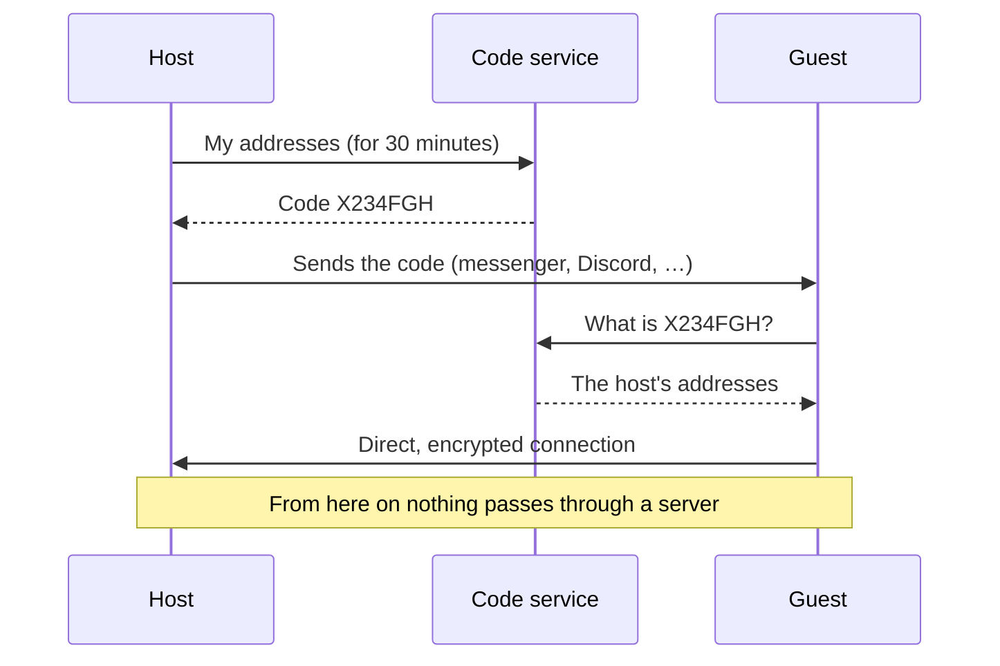

## 🔐 Security and privacy

| Concern | Answer |
|---|---|
| "Can anyone see my chat or voice?" | All traffic is encrypted with a key that belongs to that one session. There is no middle server for anything to pass through. |
| "What does the code service know about me?" | Only the host's addresses and a random code, for 30 minutes at most and only while the room is open. Never a name, message or file. |
| "What if one session leaks?" | Every session's key is fresh (ECDH); losing one says nothing about the sessions before or after. |
| "Man in the middle?" | A short safety code is shown to both sides so they can compare it another way (by voice, say). |
| "Someone posting as me?" | Identity comes from the connection, not the message text; forging or deleting other people's messages is not possible. |
| "A malicious file?" | The file name is sanitised, the file is saved marked as "from the internet", and Windows warns before it runs. A file is saved only if you accept it. |
| "A fake update?" | Only from GitHub over TLS, and verified against the announced SHA-256 before it runs; a file that does not match is not installed. |
| "My profile picture?" | Sent only to the members of the same room, and removed from their memory when you leave. |
| "What stays on my computer?" | Settings, logs and your picture in `%LOCALAPPDATA%\GoLAN` — bundled into a zip only when you ask ("Report a problem"). |

## 🕘 Version history

The full text of each version is on the **[releases page](https://github.com/parhamzare139/VirtualLANPlatform/releases)**; in short:

| Version | What came |
|:---:|---|
| **1.5.0** | A tray menu that matches the app, a simpler guide, combined emoji kept whole, no dotted frames on buttons and fields, Settings that opens at once |
| **1.4.0** | An in-app guide with search (`F1`) and "What's new" for every version |
| **1.3.x** | Join codes; one IP for the virtual network; a seven-box code field; pictures no longer mirrored in Persian |
| **1.2.x** | The GoLAN name and look; profile pictures; the full 3D emoji set; screen-share sound; a better tray |
| **1.1.0** | Rebuilt voice, a steadier connection, a second tick on messages, file sending to several people, more security |

## ❓ FAQ

<details>
<summary>Why does it need administrator access?</summary><br>

To install the virtual network adapter driver (WinTun) and add one firewall rule for that adapter. It happens once, on first run.
</details>

<details>
<summary>The code or IP does not work ("could not reach the host")</summary><br>

It is almost never the code. Check in order: the room is still open; the whole code (seven characters) is typed; Windows Firewall asked and you chose "Allow"; the host's modem has UPnP (or UDP port 42777 / 42778 is opened by hand — the in-app UPnP guide walks you through it). If the host's internet is CGNAT (several homes share one IP) nobody outside can reach them; connect through a virtual-LAN tool such as PacketRaft, or let someone else host.
</details>

<details>
<summary>"That code was not found"</summary><br>

The host closed the room, or the code expired after 30 minutes without renewal. Ask for a new one. Finding a code needs the internet; on one local network, type the host's IP instead.
</details>

<details>
<summary>The game does not see the virtual network</summary><br>

Some games do not list servers and only connect by IP: choose "LAN" or "connect by IP" and enter the host's game IP (`10.88.x.y`). The new Windows network should be "Private", and the firewall must allow the game itself.
</details>

<details>
<summary>Why was it renamed? Does the old version still work?</summary><br>

GoLAN is Virtual LAN Platform with a new name and look. Versions 1.1 and later connect with each other, and installing over the old one keeps your settings.
</details>

<details>
<summary>Is it a replacement for Hamachi or Radmin VPN?</summary><br>

For the purpose — a virtual LAN for older games — it aims at the same thing. Built-in encrypted chat, voice, screen sharing and file transfer are the extras that come with it. And if someone is connected through another virtual-LAN tool (such as PacketRaft), the join code works for them too.
</details>

<details>
<summary>Does it run on Mac or Linux?</summary><br>

Not for now — because of the WinTun driver and the WPF interface, Windows 10 (1809+) and 11 only, both 64-bit.
</details>

<details>
<summary>How do I set a profile picture?</summary><br>

Click the circle on the lobby (or Settings → General → Profile picture), choose an image, drag and zoom it in the round window and save. Others see it when the room's host is also on 1.2 or later.
</details>

<details>
<summary>The update says "install failed"</summary><br>

The app checks every update file against its fingerprint (SHA-256) and refuses one that does not match the list; that is for your safety. Try once more, and if it still fails, download the latest `GoLAN_Setup_*.exe` by hand from the releases page and run it; your name and settings are kept.
</details>

<details>
<summary>Is it open source?</summary><br>

No; it is free for personal use, but the source is closed and ownership stays with the author. Details in <a href="LICENSE">LICENSE</a>.
</details>

<details>
<summary>How do I know I have the latest version?</summary><br>

The app checks when it opens (and from Settings → About whenever you like) and, if there is a new version, walks you through downloading and installing it.
</details>

## 🛟 Support

- In-app: **Report a problem** at the bottom of the window (or Settings → About) — copies the support address and, if you want, saves your logs and network details into a zip. Nothing is sent without you.
- Email: [vlanplat.help@gmail.com](mailto:vlanplat.help@gmail.com)
- Bugs: [GitHub Issues](https://github.com/parhamzare139/VirtualLANPlatform/issues)
- Found it useful? **[Support the project](https://reymit.ir/vlanplatform)**

## 📜 License

**Proprietary Freeware** — free for personal, non-commercial use; the source is not open and may not be copied, modified or redistributed. Sharing the unmodified installer is permitted. Full text: **[LICENSE](LICENSE)**.

## 🙏 Thanks to

- **[WinTun](https://www.wintun.net/)** (the WireGuard project) — MIT License
- **[Vazirmatn](https://github.com/rastikerdar/vazirmatn)** — SIL Open Font License, for Persian text and digits
- **[Plus Jakarta Sans](https://github.com/tokotype/PlusJakartaSans)** and **[JetBrains Mono](https://github.com/JetBrains/JetBrainsMono)** — SIL Open Font License, for Latin text and IPs
- **[Fluent Emoji](https://github.com/microsoft/fluentui-emoji)** (Microsoft), via **[fluent-emoji](https://github.com/bignutty/fluent-emoji)** (bignutty) — MIT License, for the 3D emoji
- **[Lucide](https://lucide.dev/)** — ISC License, for the icons; **[LiteNetLib](https://github.com/RevenantX/LiteNetLib)**, **[NAudio](https://github.com/naudio/NAudio)**, **[Concentus](https://github.com/lostromb/concentus)** — each under its own open-source licence

<div align="center">

[⬆ بازگشت به بالا / Back to top](#golan)

</div>
