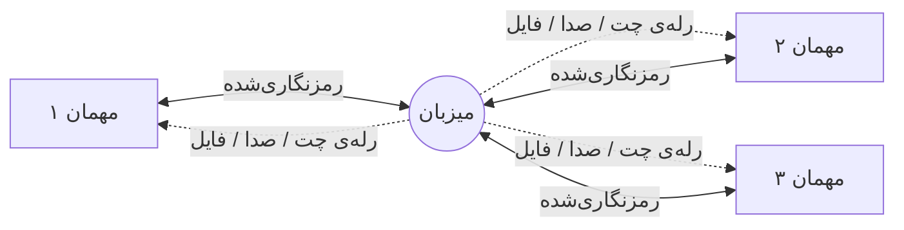

[README.md](https://github.com/user-attachments/files/34015830/README.md)
<div align="center">


# GoLAN

### شبکه‌ی مجازی نظیر‌به‌نظیر برای بازی، چت، صدا و اشتراک فایل
**بدون سرور · بدون تنظیم روتر · رمزنگاری‌شده · کاملاً فارسی**

<sub>A peer-to-peer virtual LAN for gaming, chat, voice and file sharing — no server, no router setup.<br>قبلاً با نام Virtual LAN Platform · formerly Virtual LAN Platform</sub>

<br>

[](https://github.com/parhamzare139/VirtualLANPlatform/releases/latest)
[](https://github.com/parhamzare139/VirtualLANPlatform/releases)
[](#نصب-و-شروع-سریع)
[](#tech-stack)
[](LICENSE)
[](https://github.com/parhamzare139/VirtualLANPlatform/commits/main)

**[⬇ دانلود](https://github.com/parhamzare139/VirtualLANPlatform/releases/latest) · [📋 تغییرات نسخه‌ها](https://github.com/parhamzare139/VirtualLANPlatform/releases) · [🐞 گزارش مشکل](#پشتیبانی-و-گزارش-مشکل) · [💛 حمایت از پروژه](https://reymit.ir/vlanplatform) · [🇬🇧 English](#-english)**

<br>


</div>

---

## GoLAN چیست؟

GoLAN چند کامپیوتر را روی اینترنت طوری به هم وصل می‌کند که انگار همه روی یک **شبکه‌ی محلی واقعی** نشسته‌اند. برای این کار یک آداپتور شبکه‌ی مجازی روی ویندوز می‌سازد — با درایور هسته‌ای [WinTun](https://www.wintun.net/) که پشت WireGuard هم هست — پس هر بازی یا برنامه‌ای که دنبال بازی‌های LAN می‌گردد، همین شبکه را می‌بیند.

کنار شبکه، یک **اتاق کامل** هم داخل خودِ برنامه هست: چت، تماس صوتی با حذف نویز، اشتراک صفحه و انتقال فایل مستقیم — همه روی همان یک اتصال رمزنگاری‌شده. لازم نیست هم‌زمان دیسکورد یا برنامه‌ی دیگری باز باشد.

<div align="center">

|  🎮 **بدون سرور** | 🔒 **رمزنگاری سرتاسری** | 🇮🇷 **فارسی و راست‌به‌چپ** | 🪶 **سبک و رایگان** |
|:---:|:---:|:---:|:---:|
| میزبان یکی از خود بازیکن‌هاست | کلید تازه برای هر نشست، مثل Signal | رابط، فونت و ارقام برای فارسی ساخته شده | حدود ۲۰۰ مگابایت حافظه، رایگان برای استفاده‌ی شخصی |

</div>

---

<a id="ویژگیها"></a>
## ✨ ویژگی‌ها

### 🎮 شبکه‌ی مجازی

| | |
|---|---|
| **آداپتور واقعی** | یک کارت شبکه‌ی مجازی روی ویندوز (WinTun)؛ بازی‌ها و برنامه‌های LAN-only آن را مثل شبکه‌ی خانگی می‌بینند. |
| **توپولوژی ستاره‌ای** | یک میزبان و چند مهمان. فقط میزبان به پورت باز نیاز دارد؛ ترافیک بین مهمان‌ها از او رله می‌شود. |
| **پورت خودکار** | تشخیص NAT با UPnP و STUN، از جمله تشخیص NAT اپراتوری (CGNAT) که باز کردن پورت را اصلاً ممکن نمی‌کند — و راهنمای قدم‌به‌قدم وقتی دستی لازم باشد. |
| **پایدارساز شبکه** | روی خطی که واقعاً پکت گم می‌کند، بسته‌های کوچک بازی و صدا دوبار فرستاده می‌شوند تا قطعی حس نشود. |
| **آدرس ثابت** | هر عضو یک IP منحصربه‌فرد دارد؛ میزبان پکتی را که آدرس مبدأش جعلی باشد دور می‌ریزد. |

### 💬 اتاق: چت، صدا، صفحه، فایل

- **چت** با ایموجی سه‌بعدی، ریپلای، حذف پیام (فقط برای نویسنده‌اش) و پیش‌نمایش عکس و لینک
- **عکس پروفایل** با کراپ و زوم؛ در لیست اعضا و کنار آخرین پیام هر نفر نمایش داده می‌شود، مثل تلگرام
- **تیک دیده‌شدن** — تیک دوم فقط وقتی می‌خورد که پیام واقعاً روی صفحه‌ی طرف مقابل بوده باشد
- **صدای زنده** روی Opus، با حذف نویز طیفی، تنظیم خودکار بلندی و بازسازی پکت‌های گم‌شده از روی افزونگی خودِ کدک
- **Push-to-talk** با کلید دلخواه، و نشانگر «در حال صحبت» کنار اسم هر نفر
- **اشتراک صفحه** همراه با صدای سیستم
- **انتقال فایل** مستقیم تا **۶۴ گیگابایت**، هم‌زمان به چند نفر، با تأیید SHA-256

### 🔒 امنیت

- **ECDH P-256 + AES-256-GCM** برای هر اتصال، با کلید جدا برای هر جهت و کلید تازه در هر نشست
- **کد امنیتی** قابل مقایسه بین دو طرف — همان سازوکاری که Signal و واتس‌اپ برای تشخیص حمله‌ی مرد میانی دارند
- هویت فرستنده از روی **خودِ اتصال** تعیین می‌شود، نه از محتوای پیام؛ پس کسی نمی‌تواند به اسم دیگری پیام بدهد یا پیام او را پاک کند
- پنجره‌ی ضد replay، و پاک‌سازی نام فایل و پیام (از جمله کاراکتری که پسوند `.exe` را شبیه `.jpg` نشان می‌دهد)
- فایل‌های دریافتی مثل دانلود از اینترنت علامت می‌خورند تا ویندوز پیش از اجرا هشدار بدهد
- به‌روزرسانی فقط از GitHub روی TLS و با تأیید **SHA-256** پیش از اجرا

### 🎨 تجربه‌ی کاربری

- **فارسی (راست‌به‌چپ) و انگلیسی**، با تم تیره‌ی سیاه و تم روشن
- **ارقام فارسی یا لاتین به انتخاب خودتان** — IP، پورت و کدها همیشه لاتین می‌مانند و نقطه‌ها هیچ‌وقت خراب نمی‌شوند؛ زبان ویندوز هم روی ظاهر برنامه اثری ندارد
- **فونت‌ها داخل خود برنامه‌اند** (Inter، Vazirmatn، JetBrains Mono)؛ روی هر سیستمی یک‌شکل دیده می‌شود
- انیمیشن‌های نرم و بلور ملایم پشت دیالوگ‌ها
- اجرا در پس‌زمینه (Tray)، شروع خودکار و بی‌صدا با روشن شدن ویندوز
- صدای اعلان قابل شخصی‌سازی — صدای خودتان را جای هر کدام بگذارید

<br>

<div align="center">

&nbsp;&nbsp;

<sub>تم روشن، به انگلیسی &nbsp;·&nbsp; تنظیمات: عکس پروفایل، زبان، تم و ارقام</sub>

</div>

---

<a id="نصب-و-شروع-سریع"></a>
## 🚀 نصب و شروع سریع

1. **دانلود:** از **[صفحه‌ی ریلیز](https://github.com/parhamzare139/VirtualLANPlatform/releases/latest)** فایل `GoLAN_Setup_*.exe` را بگیرید و اجرا کنید.
2. **دسترسی ادمین:** یک‌بار تأیید کنید — فقط برای نصب درایور آداپتور مجازی و یک قانون فایروال مخصوص همان آداپتور لازم است.
3. **ساخت یا ورود:** یک نفر «ساخت اتاق» را می‌زند و آدرسش را (که بالای اتاق نشان داده می‌شود و با یک کلیک کپی می‌شود) به بقیه می‌دهد. بقیه با همان آدرس وارد می‌شوند.
4. **بازی:** بازی یا برنامه‌ی LAN را باز کنید. آدرس شبکه‌ی مجازی (از نوع `10.88.x.x`) داخل برنامه نشان داده می‌شود.

<div align="center">

| نیازمندی | مقدار |
|---|---|
| سیستم‌عامل | ویندوز ۱۰ (نسخه ۱۸۰۹ به بعد) یا ویندوز ۱۱، فقط ۶۴ بیتی |
| Runtime | .NET 8 Desktop Runtime — اگر نصب نباشد، خودِ نصب‌کننده دانلودش می‌کند |
| دسترسی | ادمین، یک‌بار برای درایور آداپتور مجازی |
| پورت‌ها | UDP ‏**۴۲۷۷۷** (اتاق) و **۴۲۷۷۸** (شبکه‌ی مجازی) — فقط روی میزبان |

</div>

برای تأیید فایل نصب (اختیاری)، هش SHA-256 هر نسخه در صفحه‌ی ریلیز آمده است:

```powershell
(Get-FileHash GoLAN_Setup_*.exe -Algorithm SHA256).Hash
```

---

<a id="چطور-کار-میکند"></a>
## 🧭 چطور کار می‌کند



هر مهمان فقط **یک** اتصال مستقیم به میزبان دارد و کلید رمزنگاری‌اش هم مخصوص همان اتصال است. پیام یا صدایی که باید به همه برسد از میزبان رله می‌شود — بی‌آنکه میزبان بتواند جای کسی وانمود کند، چون هویت هر پیام از اتصالی که از آن آمده تعیین می‌شود.

میزبان روی پورت‌های بالا گوش می‌دهد. برنامه با UPnP تلاش می‌کند آن‌ها را خودش روی روتر باز کند؛ اگر نشد، راهنمای باز کردن دستی را نشان می‌دهد و با STUN تشخیص می‌دهد که اصلاً پشت NAT اپراتور هستید یا نه.

---

<a id="امنیت-و-حریم-خصوصی"></a>
## 🔐 امنیت و حریم خصوصی

<div align="center">

| نگرانی | پاسخ |
|---|---|
| «کسی چت یا صدایم را می‌بیند؟» | همه‌ی ترافیک با کلیدی رمزنگاری می‌شود که مخصوص همان یک نشست است. هیچ سرور میانی‌ای وجود ندارد که چیزی از آن رد شود. |
| «اگر یک نشست لو برود؟» | کلید هر نشست تازه است (ECDH)؛ لو رفتن یکی روی نشست‌های قبل و بعد اثری ندارد. |
| «مرد میانی؟» | کد امنیتی کوتاه به هر دو طرف نشان داده می‌شود تا از راه دیگری (مثلاً صدا) مقایسه کنند. |
| «کسی به اسم من پیام بدهد؟» | هویت از اتصال می‌آید، نه از متن پیام؛ جعل یا حذف پیام دیگران ممکن نیست. |
| «فایل مخرب؟» | نام فایل پاک‌سازی می‌شود، فایل با علامت «از اینترنت» ذخیره می‌شود و ویندوز پیش از اجرا هشدار می‌دهد. |
| «به‌روزرسانی جعلی؟» | فقط از GitHub روی TLS، و پیش از اجرا با SHA-256 اعلام‌شده تأیید می‌شود. |
| «عکس پروفایلم؟» | فقط برای اعضای همان اتاق فرستاده می‌شود و با خروج از اتاق از حافظه‌ی بقیه پاک می‌شود. |

</div>

---

<a id="tech-stack"></a>
## 🛠️ زیر کاپوت

<div align="center">

| لایه | فناوری |
|---|---|
| رابط کاربری | WPF روی .NET 8 |
| شبکه | [LiteNetLib](https://github.com/RevenantX/LiteNetLib) (UDP) + [WinTun](https://www.wintun.net/) برای آداپتور مجازی |
| صدا | Opus (از طریق Concentus) + NAudio |
| رمزنگاری | ECDH P-256 · AES-256-GCM · HKDF — پیاده‌سازی خودِ .NET |
| ذخیره‌سازی محلی | SQLite |

</div>

---

<a id="سوالات-متداول"></a>
## ❓ سوالات متداول

<details>
<summary>چرا برنامه به دسترسی ادمین نیاز دارد؟</summary><br>

برای نصب درایور آداپتور شبکه‌ی مجازی (WinTun) و اضافه کردن یک قانون فایروال مخصوص همان آداپتور. این کار فقط یک‌بار، موقع اولین اجراست.
</details>

<details>
<summary>اسم برنامه چرا عوض شد؟ نسخه‌ی قبلی هنوز کار می‌کند؟</summary><br>

GoLAN همان Virtual LAN Platform است با اسم و ظاهر جدید. نسخه‌های ۱.۱ به بعد با هم وصل می‌شوند و نصب جدید روی نسخه‌ی قبلی، تنظیمات شما را نگه می‌دارد.
</details>

<details>
<summary>آیا جایگزین Hamachi یا Radmin VPN است؟</summary><br>

از نظر کاربرد — ساختن یک LAN مجازی برای بازی‌های قدیمی — هدف مشابهی دارد. چت، صدا، اشتراک صفحه و انتقال فایل داخلی و رمزنگاری‌شده، بخش اضافه‌ای است که کنارش می‌آید.
</details>

<details>
<summary>روی مک یا لینوکس کار می‌کند؟</summary><br>

فعلاً نه — به‌خاطر درایور WinTun و رابط WPF، فقط ویندوز ۱۰ (۱۸۰۹ به بعد) و ۱۱، هر دو ۶۴ بیتی.
</details>

<details>
<summary>چطور عکس پروفایل بگذارم؟</summary><br>

تنظیمات ← عمومی ← عکس پروفایل. عکس را انتخاب کنید، در پنجره‌ی گرد جابه‌جا و بزرگ و کوچکش کنید و ذخیره بزنید. دیگران وقتی می‌بینند که میزبان اتاق هم از نسخه‌ی ۱.۲ به بعد باشد.
</details>

<details>
<summary>سورس باز است؟</summary><br>

نه؛ رایگان برای استفاده‌ی شخصی است، ولی سورس بسته است و مالکیت آن نزد نویسنده می‌ماند. جزئیات در <a href="LICENSE">LICENSE</a>.
</details>

<details>
<summary>چطور بفهمم آخرین نسخه را دارم؟</summary><br>

برنامه هنگام باز شدن (و از تنظیمات، هر وقت بخواهید) نسخه‌ی جدید را بررسی می‌کند و اگر بود، دانلود و نصبش را قدم‌به‌قدم پیش می‌برد.
</details>

---

<a id="پشتیبانی-و-گزارش-مشکل"></a>
## 🛟 پشتیبانی و گزارش مشکل

- **داخل برنامه:** تنظیمات ← گزارش مشکل — یک بسته‌ی تشخیصی می‌سازد و ایمیل را برایتان آماده می‌کند.
- **ایمیل:** [vlanplat.help@gmail.com](mailto:vlanplat.help@gmail.com)
- **گزارش باگ عمومی:** [GitHub Issues](https://github.com/parhamzare139/VirtualLANPlatform/issues)
- اگر برنامه به کارتان آمد و خواستید حمایت کنید: **[reymit.ir/vlanplatform](https://reymit.ir/vlanplatform)**

---

## 📜 مجوز

**Proprietary Freeware** — رایگان برای استفاده‌ی شخصی و غیرتجاری؛ سورس‌کد باز نیست و کپی، تغییر یا توزیع مجدد سورس مجاز نیست. توزیع خودِ فایل نصب/اجرایی بدون تغییر آزاد است. متن کامل: **[LICENSE](LICENSE)**.

## 🙏 با تشکر از

- **[WinTun](https://www.wintun.net/)** (پروژه‌ی WireGuard) — MIT License
- **[Vazirmatn](https://github.com/rastikerdar/vazirmatn)** — SIL Open Font License، برای متن و ارقام فارسی
- **[Inter](https://github.com/rsms/inter)** و **[JetBrains Mono](https://github.com/JetBrains/JetBrainsMono)** — SIL Open Font License، برای متن لاتین و IPها
- زیرمجموعه‌ای از **[fluent-emoji](https://github.com/bignutty/fluent-emoji)** (bignutty) — MIT License

<div align="center">
<sub>ساخته‌شده برای بازی و کار گروهی؛ بدون سرور، بدون پیچیدگی.</sub>
</div>

---
---

<a id="-english"></a>
# 🇬🇧 English

<div align="center">

**A peer-to-peer virtual LAN for gaming, chat, voice and file sharing — no server, no router setup.**

</div>

GoLAN (formerly Virtual LAN Platform) creates a real virtual network adapter on Windows — using [WinTun](https://www.wintun.net/), the same kernel driver behind WireGuard — and links several computers over the internet as if they were on one physical LAN. Any game or application that looks for a local network sees this one: there is no central server and no manual port forwarding for anyone except the host.

Alongside the network, the app carries its own room: text chat, noise-suppressed voice calls, screen sharing and direct peer-to-peer file transfer, all over the same encrypted connection.

### Highlights

- **Virtual LAN** — a real Windows network adapter; star topology, so only the host needs an open port; automatic UPnP/STUN port mapping with carrier-grade NAT detection; a network stabilizer that duplicates small real-time packets on a lossy link.
- **Chat, voice & screen share** — replies, image previews, author-only delete, Telegram-style read receipts, **profile pictures** with crop and zoom; Opus voice with spectral noise suppression, automatic gain and loss concealment; push-to-talk; direct file transfer up to **64 GB** to several people at once, SHA-256 verified.
- **Security** — ECDH P-256 + AES-256-GCM per connection with a fresh key every session and a separate key per direction; a comparable safety code (the mechanism Signal and WhatsApp use against man-in-the-middle attacks); sender identity comes from the connection, never from the message; replay protection; file-name sanitisation, including the RTL-override trick that disguises an executable as an image; received files are marked as from the internet; updates are pinned to GitHub over TLS and verified against a SHA-256 hash.
- **Interface** — fully localised into Persian (RTL) and English, a near-black dark theme and a light one, a choice of Persian or Latin digits that never touches IPs or ports, bundled fonts so it looks identical everywhere, smooth motion, tray mode, custom notification sounds.

### Quick start

1. Download `GoLAN_Setup_*.exe` from the **[latest release](https://github.com/parhamzare139/VirtualLANPlatform/releases/latest)**.
2. Grant administrator access once — only to install the virtual adapter driver and its firewall rule.
3. One person creates a room and shares its address; everyone else connects.
4. Open your LAN game or app. The virtual network's `10.88.x.x` address is shown right in the app.

| Requirement | Value |
|---|---|
| OS | Windows 10 (1809+) or Windows 11, 64-bit only |
| Runtime | .NET 8 Desktop Runtime — installed automatically if missing |
| Access | Administrator, once, for the virtual adapter |
| Ports (host only) | UDP **42777** (room) and **42778** (virtual network) |

### Support

- In-app: Settings → Report a problem
- Email: [vlanplat.help@gmail.com](mailto:vlanplat.help@gmail.com)
- Bugs: [GitHub Issues](https://github.com/parhamzare139/VirtualLANPlatform/issues)
- Found it useful? **[Support the project](https://reymit.ir/vlanplatform)**

### License

**Proprietary Freeware** — free for personal, non-commercial use; the source is not open and may not be copied, modified or redistributed. Sharing the unmodified installer is permitted. Full text: **[LICENSE](LICENSE)**.

<div align="center">

[⬆ بازگشت به بالا / Back to top](#golan)

</div>
